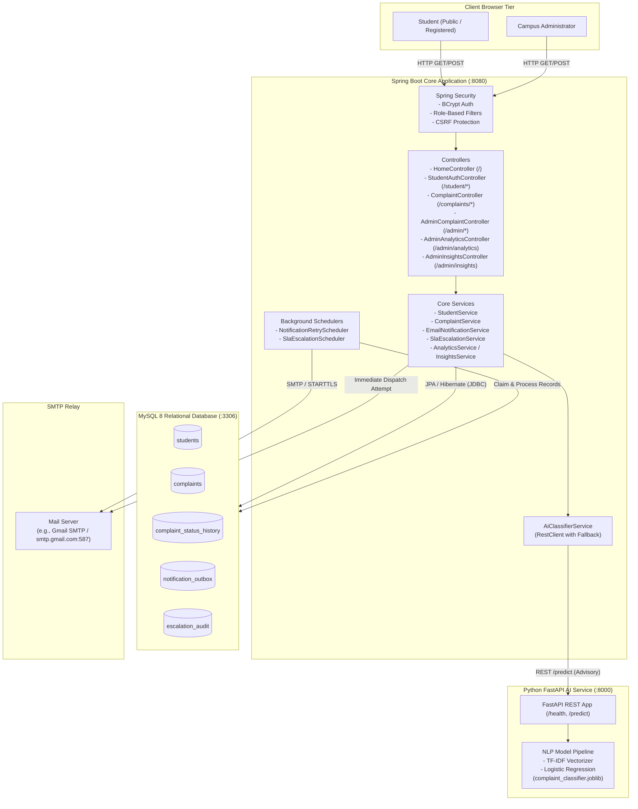

# CampusPulse

> **Institutional Grievance Redressal and Operations Intelligence Platform**  
> Built with **Java 21**, **Spring Boot 4**, **Spring Security**, **Thymeleaf**, **MySQL 8**, and an offline **Python FastAPI** microservice for local Machine Learning classification.

---

## Table of Contents

- [1. Project Overview](#1-project-overview)
- [2. Problem Statement and Motivation](#2-problem-statement-and-motivation)
- [3. Key Features](#3-key-features)
  - [Student Experience](#student-experience)
  - [Administrator Management](#administrator-management)
  - [AI & Machine Learning](#ai--machine-learning)
  - [Notification & Reliability Engine](#notification--reliability-engine)
- [4. Technology Stack](#4-technology-stack)
- [5. System Architecture](#5-system-architecture)
  - [High-Level Architecture](#high-level-architecture)
  - [Mermaid Architecture Diagram](#mermaid-architecture-diagram)
- [6. Project Directory Structure](#6-project-directory-structure)
- [7. Prerequisites & Installation](#7-prerequisites--installation)
- [8. MySQL Database Setup](#8-mysql-database-setup)
- [9. Environment Configuration](#9-environment-configuration)
  - [Critical Note on `.env` Files in Spring Boot](#critical-note-on-env-files-in-spring-boot)
  - [Configuration Variable Reference](#configuration-variable-reference)
- [10. Step-by-Step Setup & Execution](#10-step-by-step-setup--execution)
  - [Step 1: Python AI Microservice Setup & Model Generation](#step-1-python-ai-microservice-setup--model-generation)
  - [Step 2: Spring Boot Application Execution](#step-2-spring-boot-application-execution)
- [11. Authentication & Account Management](#11-authentication--account-management)
  - [Administrator Account Setup](#administrator-account-setup)
  - [Student Registration & Sign-In](#student-registration--sign-in)
- [12. Running Test Suites](#12-running-test-suites)
  - [Java Test Suite (262 Tests)](#java-test-suite-262-tests)
  - [Python Test Suite (16 Tests)](#python-test-suite-16-tests)
- [13. API Endpoints Reference](#13-api-endpoints-reference)
  - [Spring Boot Web & REST Routes](#spring-boot-web--rest-routes)
  - [Python FastAPI AI Microservice](#python-fastapi-ai-microservice)
- [14. Complaint Lifecycle, SLA, & Audit History](#14-complaint-lifecycle-sla--audit-history)
  - [Lifecycle Status Transitions](#lifecycle-status-transitions)
  - [Priority Classification](#priority-classification)
  - [Service Level Agreements (SLA) & Automated Escalation](#service-level-agreements-sla--automated-escalation)
  - [Transactional Outbox Email Notification Pipeline](#transactional-outbox-email-notification-pipeline)
  - [Immutable Audit Trail](#immutable-audit-trail)
- [15. AI Model Capabilities & Disclosure](#15-ai-model-capabilities--disclosure)
- [16. Security Implementation & Privacy Safeguards](#16-security-implementation--privacy-safeguards)
- [17. Screenshots Guide](#17-screenshots-guide)
- [18. Troubleshooting Guide](#18-troubleshooting-guide)
- [19. Future Improvements](#19-future-improvements)
- [20. Contributing, Git Hygiene, & License](#20-contributing-git-hygiene--license)

---

## 1. Project Overview

**CampusPulse** is an institutional grievance redressal and operational intelligence platform engineered for colleges, universities, and polytechnic campuses. It provides a centralized digital ecosystem for students to register complaints across campus departments and track resolution timelines, while equipping administrators with SLA-governed queues, audit history, automated escalations, and executive operational analytics.

The platform pairs a robust **Spring Boot 4** server-side core with a private, lightweight **Python FastAPI** natural language processing microservice. The AI service provides real-time, non-intrusive category recommendations during complaint filing while operating 100% offline—ensuring zero external API fees and total student data privacy.

---

## 2. Problem Statement and Motivation

Traditional campus grievance processes suffer from critical structural weaknesses:

1. **Fragmented & Opaque Channels:** Students are forced to file complaints through physical paper forms, informal emails, or verbal reports to disparate department offices, leading to misplaced grievances and zero visibility into resolution progress.
2. **Lack of Accountability & SLA Monitoring:** Administrative offices lack automated tracking to ensure grievances are reviewed or resolved within established university timelines, resulting in unattended backlogs and student dissatisfaction.
3. **No Operational Intelligence:** University management lacks real-time analytics to pinpoint recurring departmental infrastructure failures, recurrent dining issues, or administrative bottlenecks.
4. **Data Privacy in AI Redressal:** Cloud-hosted AI solutions expose student grievance text and personal details to third-party APIs. CampusPulse addresses this with a self-hosted, offline NLP classification model that keeps institutional data within the campus perimeter.

---

## 3. Key Features

### Student Experience
- **Modern Responsive SaaS UI:** Clean, mobile-friendly interface designed with high-contrast typography, accessible forms, and clear visual hierarchy.
- **Dedicated Student Authentication:** Self-registration (`/student/register`) with client and server-side validation, password confirmation, and BCrypt security.
- **Student Sign-In (`/student/login`):** Role-aware authentication redirecting students directly to their filing dashboard.
- **Structured Complaint Filing (`/complaints/new`):** Validated form capturing title, department, description, priority, and student contact details.
- **Advisory AI Category Suggestions:** Real-time ML suggestions assist students in selecting the most appropriate department category without overriding user choice.
- **Self-Service Reference Tracking (`/complaints/track`):** Public status tracking using unique identifiers (`CP-YYYY-XXXXXXXX`) displaying timeline stages, SLA status, and resolution remarks while redacting sensitive personal information.
- **Automated Email Receipts:** Immediate confirmation emails with direct tracking hyperlinks upon successful submission.

### Administrator Management
- **Role-Based Access Control (`/admin/**`):** Protected administrative management suite secured with Spring Security `ROLE_ADMIN`.
- **Advanced Filtering & Search:** Filter grievances by lifecycle status, category, department, priority, or free-text search across titles, descriptions, and reference IDs.
- **Complaint Detail & Workflow Portal (`/admin/complaints/{id}`):** Full visibility into student details, priority, departmental assignment, SLA countdowns, and historical status changes.
- **Governed Status Transitions:** Enforced workflow states (`SUBMITTED` &rarr; `UNDER_REVIEW` &rarr; `IN_PROGRESS` &rarr; `RESOLVED` / `REJECTED`) requiring admin remarks for resolution or rejection.
- **Priority & Department Reassignment:** Reallocate grievances to appropriate staff and adjust urgency levels (`LOW`, `MEDIUM`, `HIGH`, `CRITICAL`).
- **Executive Operations Analytics (`/admin/analytics`):** Real-time KPI summary cards (Total Complaints, Open Backlog, Resolution Rate, SLA Adherence), departmental load breakdowns, category distributions, and daily volume trend graphs.
- **Heuristic AI Insights (`/admin/insights`):** Automated backlog bottleneck detection, week-over-week trend comparisons, and rule-based operational recommendations.

### AI & Machine Learning
- **100% Local Inference:** Offline FastAPI service running TF-IDF feature extraction and Logistic Regression classification across 6 institutional categories.
- **Privacy-Preserving:** No student data, grievance text, or metadata leaves the local server boundary.
- **Fault-Tolerant & Fail-Safe:** If the Python microservice is offline, slow, or returning errors, complaint submission proceeds without interruption.
- **Strictly Advisory:** The student retains complete autonomy to accept, change, or ignore the suggested category.

### Notification & Reliability Engine
- **Transactional Outbox Pattern:** Outbox records (`notification_outbox`) are committed within the same database transaction as complaint state changes, eliminating lost emails during system crashes.
- **Automated Retry Scheduler:** Background worker polling failed or pending notifications with exponential backoff and pessimistic in-flight locking.
- **Error Taxonomy:** Distinguishes transient transport glitches (eligible for retry) from permanent errors (e.g., malformed recipient addresses or non-retryable 5xx failures).
- **Automated SLA Escalation Worker:** Schedulers monitor pending response and resolution deadlines, triggering escalation records (`escalation_audit`) and dispatching admin alerts when service windows are breached.

---

## 4. Technology Stack

| Layer | Technology | Version | Purpose |
|---|---|---|---|
| **Backend Core** | Java | 21 (LTS) | Modern language runtime |
| **Framework** | Spring Boot | 4.0.8 | Application server, DI, MVC, and Data JPA |
| **Security** | Spring Security | 6.x | Form authentication, BCrypt hashing, RBAC, CSRF |
| **View Engine** | Thymeleaf | 3.x | Server-side template rendering with HTML5 semantics |
| **Styling** | Vanilla CSS3 | Custom Design System | SaaS UI styling, responsive layout, CSS variables |
| **Database** | MySQL | 8.0+ | Relational persistence with InnoDB engine |
| **Testing DB** | H2 Database | 2.x | Fast, zero-config in-memory database for automated tests |
| **AI Framework** | Python | 3.10+ (tested on 3.13) | Lightweight NLP service execution |
| **AI Web Server** | FastAPI & Uvicorn | 0.115+ / 0.30+ | Asynchronous REST API microservice |
| **Machine Learning**| scikit-learn & pandas | 1.5+ / 2.2+ | TF-IDF vectorization and Logistic Regression pipeline |
| **Build Tools** | Apache Maven | 3.9+ (via `./mvnw`) | Java build, dependency management, and test runner |
| **Python Testing** | pytest & httpx | 8.2+ / 0.27+ | Python unit testing and REST endpoint validation |

---

## 5. System Architecture

### High-Level Architecture

CampusPulse follows a decoupled microservice-assisted architecture:
1. **Client Tier:** Students and administrators access responsive Thymeleaf-rendered web pages via any modern web browser over HTTP/HTTPS.
2. **Application Tier:** The Spring Boot application handles routing, authentication, business logic, transaction boundaries, and background scheduling.
3. **Persistence Tier:** MySQL 8 stores structured records across 5 primary tables (`students`, `complaints`, `complaint_status_history`, `notification_outbox`, `escalation_audit`).
4. **AI Microservice Tier:** The Python FastAPI service exposes local REST endpoints (`/health`, `/predict`) over HTTP port 8000 for advisory categorization.

### Mermaid Architecture Diagram



---

## 6. Project Directory Structure

```text
CampusPulse/
├── pom.xml                                    # Maven project configuration and dependencies
├── mvnw                                       # Maven wrapper shell script (macOS/Linux)
├── mvnw.cmd                                   # Maven wrapper batch script (Windows)
├── .env.example                               # Environment configuration template with safe placeholders
├── .gitignore                                 # Git exclusion rules (build, venv, secrets, artifacts)
├── README.md                                  # Complete technical documentation
├── ai-service/                                # Python NLP Microservice
│   ├── requirements.txt                       # Python dependencies (FastAPI, scikit-learn, etc.)
│   ├── app/
│   │   ├── __init__.py
│   │   ├── main.py                            # FastAPI entry point, lifespan, CORS, and endpoints
│   │   ├── predictor.py                       # Model loader, thread-safe inference, and fallbacks
│   │   └── schemas.py                         # Pydantic request and response schemas
│   ├── data/
│   │   └── demo_complaints.csv                # Balanced synthetic training dataset (60 samples, 6 classes)
│   ├── models/
│   │   ├── model_metadata.json                # Model training metrics, version, and parameters
│   │   └── complaint_classifier.joblib        # Generated model binary (git-ignored, recreated via train.py)
│   ├── training/
│   │   ├── __init__.py
│   │   └── train.py                           # Dataset validation and offline model training script
│   └── tests/
│       ├── __init__.py
│       ├── conftest.py                        # Pytest fixtures and test client configuration
│       ├── test_health.py                     # Health endpoint verification
│       ├── test_predict.py                    # Inference validation, confidence bounds, 503 fallback
│       └── test_training.py                   # Dataset validation and training pipeline tests
└── src/
    ├── main/
    │   ├── java/com/campuspulse/
    │   │   ├── CampuspulseApplication.java     # Spring Boot application entry point
    │   │   ├── config/                        # Security, scheduling, SLA properties, auth handlers
    │   │   │   ├── CustomAuthenticationFailureHandler.java
    │   │   │   ├── RoleBasedAuthenticationSuccessHandler.java
    │   │   │   ├── SchedulingConfig.java
    │   │   │   ├── SecurityConfig.java
    │   │   │   └── SlaProperties.java
    │   │   ├── controller/                    # Spring MVC web controllers
    │   │   │   ├── AdminAnalyticsController.java
    │   │   │   ├── AdminComplaintController.java
    │   │   │   ├── AdminInsightsController.java
    │   │   │   ├── AuthController.java
    │   │   │   ├── ComplaintController.java
    │   │   │   ├── HomeController.java
    │   │   │   └── StudentAuthController.java
    │   │   ├── dto/                           # Data Transfer Objects and form bindings
    │   │   │   ├── AiClassificationResult.java
    │   │   │   ├── AiSuggestRequest.java
    │   │   │   ├── AiSuggestResponse.java
    │   │   │   ├── ComplaintForm.java
    │   │   │   ├── StudentRegisterForm.java
    │   │   │   ├── analytics/                 # KPI and chart aggregation DTOs
    │   │   │   └── insights/                  # Heuristic recommendation DTOs
    │   │   ├── model/                         # JPA database entities and enums
    │   │   │   ├── Complaint.java
    │   │   │   ├── ComplaintEscalationAudit.java
    │   │   │   ├── ComplaintPriority.java
    │   │   │   ├── ComplaintStatus.java
    │   │   │   ├── ComplaintStatusHistory.java
    │   │   │   ├── NotificationOutbox.java
    │   │   │   ├── NotificationStatus.java
    │   │   │   ├── NotificationType.java
    │   │   │   ├── SlaEscalationStage.java
    │   │   │   └── Student.java
    │   │   ├── repository/                    # Spring Data JPA repositories
    │   │   │   ├── ComplaintEscalationAuditRepository.java
    │   │   │   ├── ComplaintRepository.java
    │   │   │   ├── ComplaintStatusHistoryRepository.java
    │   │   │   ├── NotificationOutboxRepository.java
    │   │   │   └── StudentRepository.java
    │   │   ├── scheduler/                     # Background scheduled workers
    │   │   │   ├── NotificationRetryScheduler.java
    │   │   │   └── SlaEscalationScheduler.java
    │   │   └── service/                       # Business logic services
    │   │       ├── AiClassifierService.java
    │   │       ├── AnalyticsService.java
    │   │       ├── ComplaintService.java
    │   │       ├── EmailNotificationService.java
    │   │       ├── InsightsService.java
    │   │       ├── NotificationService.java
    │   │       ├── SlaEscalationService.java
    │   │       └── StudentService.java
    │   └── resources/
    │       ├── application.properties         # Application configuration with environment variable fallbacks
    │       ├── static/css/
    │       │   └── style.css                  # Custom SaaS design system CSS
    │       └── templates/                     # Thymeleaf HTML5 templates
    │           ├── index.html                 # Platform landing page
    │           ├── login.html                 # Administrator login portal
    │           ├── admin/
    │           │   ├── analytics/index.html   # Operations analytics dashboard
    │           │   ├── complaints/detail.html # Case detail, status transition, and audit trail
    │           │   ├── complaints/index.html  # Admin complaint queue with filters and pagination
    │           │   └── insights/index.html    # AI insights and bottleneck recommendations
    │           ├── complaints/
    │           │   ├── form.html              # Complaint submission form with AI suggestion
    │           │   ├── list.html              # Public complaint registry
    │           │   ├── success.html           # Submission confirmation receipt
    │           │   └── track.html             # Self-service status tracking portal
    │           └── student/
    │               ├── login.html             # Dedicated student login view
    │               └── register.html          # Student self-registration portal
    └── test/java/com/campuspulse/             # Automated Java unit & integration tests (262 tests)
```

---

## 7. Prerequisites & Installation

Verify that the following runtimes and developer tools are available on your system:

| Tool | Minimum Version | Check Command |
|---|---|---|
| **Java JDK** | 21 (LTS) or higher | `java -version` |
| **Python** | 3.10 or higher | `python3 --version` |
| **MySQL Server** | 8.0 or higher | `mysql --version` |
| **Git** | 2.30 or higher | `git --version` |

---

## 8. MySQL Database Setup

1. Connect to your local MySQL instance as an administrative user:
   ```bash
   mysql -u root -p
   ```

2. Execute the following SQL commands to create the dedicated database schema and restricted application user:
   ```sql
   CREATE DATABASE campuspulse_db 
     CHARACTER SET utf8mb4 
     COLLATE utf8mb4_unicode_ci;

   CREATE USER 'campuspulse_app'@'localhost' IDENTIFIED BY 'REPLACE_WITH_STRONG_DB_PASSWORD';

   GRANT ALL PRIVILEGES ON campuspulse_db.* TO 'campuspulse_app'@'localhost';

   FLUSH PRIVILEGES;
   ```

3. **Automatic Schema Migration:**  
   CampusPulse uses Spring Data JPA with `spring.jpa.hibernate.ddl-auto=update`. When the application boots, Hibernate automatically inspects the entity models (`students`, `complaints`, `complaint_status_history`, `notification_outbox`, `escalation_audit`) and creates or updates all required tables, columns, indexes, and foreign keys.

---

## 9. Environment Configuration

### Critical Note on `.env` Files in Spring Boot

> [!IMPORTANT]
> Standard Spring Boot applications **do not automatically parse `.env` files** into the JVM process environment. Copying `.env.example` to `.env` alone will **not** pass variables to Spring Boot.

To apply environment variables locally on macOS / Linux:
```bash
# Option A: Export directly in terminal
export DB_USERNAME="campuspulse_app"
export DB_PASSWORD="REPLACE_WITH_STRONG_DB_PASSWORD"
export ADMIN_PASSWORD="REPLACE_WITH_STRONG_ADMIN_PASSWORD"

# Option B: Source a local .env file
set -a
source .env
set +a
```

### Configuration Variable Reference

All variables listed below are bound in [`application.properties`](file:///Users/rohityadav/Projects/CampusPulse/src/main/resources/application.properties) with safe local fallbacks:

| Environment Variable | Bound Property in `application.properties` | Safe Default Value | Description |
|---|---|---|---|
| `DB_URL` | `spring.datasource.url` | `jdbc:mysql://localhost:3306/campuspulse_db` | MySQL JDBC connection string |
| `DB_USERNAME` | `spring.datasource.username` | `campuspulse_app` | Dedicated database user |
| `DB_PASSWORD` | `spring.datasource.password` | `""` (empty) | Database user password |
| `ADMIN_USERNAME` | `campuspulse.admin.username` | `admin` | Administrator login username |
| `ADMIN_PASSWORD` | `campuspulse.admin.password` | `""` (empty) | Admin password (hashed with BCrypt on boot; if omitted, a secure UUID is generated) |
| `ADMIN_PASSWORD_HASH` | `campuspulse.admin.password-hash` | `""` (empty) | Optional pre-computed BCrypt hash (overrides `ADMIN_PASSWORD`) |
| `SMTP_HOST` | `spring.mail.host` | `smtp.gmail.com` | Outgoing SMTP server hostname |
| `SMTP_PORT` | `spring.mail.port` | `587` | Outgoing SMTP port (STARTTLS standard: 587) |
| `SMTP_USERNAME` | `spring.mail.username` | `your_email@gmail.com` | Authenticated email address |
| `SMTP_PASSWORD` | `spring.mail.password` | `""` (empty) | 16-character Google App Password (never personal password) |
| `SMTP_AUTH` | `spring.mail.properties.mail.smtp.auth` | `true` | Enable SMTP authentication |
| `SMTP_STARTTLS` | `spring.mail.properties.mail.smtp.starttls.enable` | `true` | Enable STARTTLS encryption |
| `SMTP_STARTTLS_REQUIRED` | `spring.mail.properties.mail.smtp.starttls.required` | `true` | Require STARTTLS encryption |
| `MAIL_FROM` | `campuspulse.mail.from` | `your_email@gmail.com` | From email address displayed to students |
| `APP_BASE_URL` | `campuspulse.app.base-url` | `http://localhost:8080` | Public base URL used in notification tracking links |
| `NOTIFICATION_RETRY_ENABLED` | `campuspulse.notifications.retry.enabled` | `true` | Master switch for background email retry worker |
| `NOTIFICATION_RETRY_INTERVAL_MS` | `campuspulse.notifications.retry.interval-ms` | `60000` | Retry scheduler polling interval (1 min) |
| `NOTIFICATION_RETRY_INITIAL_DELAY_MS` | `campuspulse.notifications.retry.initial-delay-ms` | `10000` | Delay before first retry check on startup (10s) |
| `NOTIFICATION_RETRY_MAX_ATTEMPTS` | `campuspulse.notifications.retry.max-attempts` | `3` | Maximum attempts before marking `PERMANENTLY_FAILED` |
| `NOTIFICATION_RETRY_INITIAL_BACKOFF_MS` | `campuspulse.notifications.retry.initial-backoff-ms` | `30000` | Initial retry backoff interval (30s) |
| `NOTIFICATION_RETRY_BACKOFF_MULTIPLIER` | `campuspulse.notifications.retry.backoff-multiplier` | `2.0` | Exponential backoff multiplier |
| `NOTIFICATION_RETRY_MAX_BACKOFF_MS` | `campuspulse.notifications.retry.max-backoff-ms` | `300000` | Maximum backoff delay ceiling (5 min) |
| `NOTIFICATION_RETRY_STALE_THRESHOLD_MS` | `campuspulse.notifications.retry.stale-threshold-ms` | `300000` | Reclaim threshold for stuck in-flight locks (5 min) |
| `AI_SERVICE_URL` | `campuspulse.ai.service-url` | `http://127.0.0.1:8000` | HTTP URL of the Python FastAPI microservice |
| `AI_CONNECT_TIMEOUT_MS` | `campuspulse.ai.connect-timeout-ms` | `2000` | Connection timeout to AI service (2s) |
| `AI_READ_TIMEOUT_MS` | `campuspulse.ai.read-timeout-ms` | `3000` | Response read timeout from AI service (3s) |
| `SLA_RESPONSE_HOURS` | `campuspulse.sla.default-response-hours` | `24` | Target response deadline (first status change) in hours |
| `SLA_RESOLUTION_HOURS` | `campuspulse.sla.default-resolution-hours` | `72` | Target resolution deadline in hours |
| `SLA_APPROACHING_HOURS` | `campuspulse.sla.approaching-deadline-hours` | `6` | Warning window before deadline expiration in hours |
| `SLA_TIMEZONE` | `campuspulse.sla.timezone` | `Asia/Kolkata` | Timezone ID for SLA calculations |
| `ADMIN_ESCALATION_EMAIL` | `campuspulse.sla.admin-escalation-email` | `admin@campuspulse.edu` | Recipient email address for SLA escalation alerts |
| `SLA_ESCALATION_ENABLED` | `campuspulse.sla.escalation.enabled` | `true` | Master switch for automated SLA escalation scheduler |
| `SLA_ESCALATION_INTERVAL_MS` | `campuspulse.sla.escalation.interval-ms` | `60000` | SLA escalation check polling interval (1 min) |
| `SLA_ESCALATION_INITIAL_DELAY_MS` | `campuspulse.sla.escalation.initial-delay-ms` | `15000` | Delay before first SLA check on startup (15s) |

---

## 10. Step-by-Step Setup & Execution

### Step 1: Python AI Microservice Setup & Model Generation

1. Navigate to the `ai-service` directory:
   ```bash
   cd ai-service
   ```

2. Create and activate a Python virtual environment:
   ```bash
   python3 -m venv .venv
   source .venv/bin/activate   # On Windows: .venv\Scripts\activate
   ```

3. Install required dependencies:
   ```bash
   pip install --upgrade pip
   pip install -r requirements.txt
   ```

4. **Train the classification model artifact:**
   ```bash
   python -m training.train
   ```
   *This trains the `TfidfVectorizer` + `LogisticRegression` pipeline on `data/demo_complaints.csv` and outputs `models/complaint_classifier.joblib`.*

5. Launch the FastAPI microservice with Uvicorn:
   ```bash
   uvicorn app.main:app --host 127.0.0.1 --port 8000 --reload
   ```

6. Confirm the service is healthy:
   ```bash
   curl http://127.0.0.1:8000/health
   ```
   *Expected response: `{"status":"ok","model_loaded":true,"can_predict":true,...}`*

### Step 2: Spring Boot Application Execution

1. Open a new terminal session in the repository root (`CampusPulse`):
2. Export your local database credentials and admin password:
   ```bash
   export DB_USERNAME="campuspulse_app"
   export DB_PASSWORD="REPLACE_WITH_STRONG_DB_PASSWORD"
   export ADMIN_PASSWORD="REPLACE_WITH_STRONG_ADMIN_PASSWORD"
   ```
   *(Optional: If testing live Gmail delivery, also export `SMTP_PASSWORD="your-16-char-app-password"`)*

3. Run the Spring Boot application using the Maven Wrapper:
   ```bash
   ./mvnw spring-boot:run
   ```

4. The platform will boot on port `8080`. Open your browser to explore the following routes:
   - **Landing Page:** [http://localhost:8080/](http://localhost:8080/)
   - **Submit Complaint:** [http://localhost:8080/complaints/new](http://localhost:8080/complaints/new)
   - **Track Complaint:** [http://localhost:8080/complaints/track](http://localhost:8080/complaints/track)
   - **Student Registration:** [http://localhost:8080/student/register](http://localhost:8080/student/register)
   - **Student Login:** [http://localhost:8080/student/login](http://localhost:8080/student/login)
   - **Admin Login:** [http://localhost:8080/login](http://localhost:8080/login)
   - **Admin Complaints Queue:** [http://localhost:8080/admin/complaints](http://localhost:8080/admin/complaints)
   - **Admin Analytics:** [http://localhost:8080/admin/analytics](http://localhost:8080/admin/analytics)
   - **Admin AI Insights:** [http://localhost:8080/admin/insights](http://localhost:8080/admin/insights)

---

## 11. Authentication & Account Management

CampusPulse implements dual-role Spring Security authentication with custom failure and success handlers (`RoleBasedAuthenticationSuccessHandler`):

### Administrator Account Setup
- **Configuration:** Admin credentials are configured via environment variables:
  ```bash
  export ADMIN_USERNAME="admin"
  export ADMIN_PASSWORD="YourStrongPassword123!"
  ```
- **Login Portal:** Access [http://localhost:8080/login](http://localhost:8080/login).
- **Post-Login Routing:** Authenticated administrators (`ROLE_ADMIN`) are automatically directed to the management queue at `/admin/complaints`.
- **Default Fallback:** If `ADMIN_PASSWORD` is left unset, Spring Boot generates a cryptographically secure random UUID password at startup and logs an alert.

### Student Registration & Sign-In
- **Registration Portal:** Access [http://localhost:8080/student/register](http://localhost:8080/student/register).
- **Required Fields:**
  - **Full Name** (2–100 characters)
  - **Student Email** (must be a valid institutional email format)
  - **Student Roll / ID** (optional, up to 50 characters)
  - **Department** (optional, e.g., Computer Science, Mechanical)
  - **Password** (minimum 8 characters, must include at least one uppercase letter, one lowercase letter, and one number)
  - **Confirm Password** (must match)
- **Persistence:** Passwords are salted and hashed using `BCryptPasswordEncoder` and persisted in the MySQL `students` table.
- **Student Login:** Students log in at [http://localhost:8080/student/login](http://localhost:8080/student/login). Upon successful authentication (`ROLE_STUDENT`), they are routed directly to the complaint submission form at `/complaints/new`.

---

## 12. Running Test Suites

### Java Test Suite (262 Tests)

The Spring Boot test suite utilizes an embedded in-memory H2 database with mock mail and REST clients. **It does not require MySQL or the Python microservice to be running.**

```bash
./mvnw test
```

**Verification Results:**
- **Tests run:** 262
- **Failures:** 0
- **Errors:** 0
- **Skipped:** 0
- **Build Status:** `BUILD SUCCESS`

#### Key Test Coverage Breakdown:
- `ComplaintRepositoryTest`: Complex JPQL multi-filter queries, pagination, status distribution, and optimistic locking.
- `ComplaintServiceTest`: Status transition state machine, reference ID formatting, audit history creation, and priority mutations.
- `StudentAuthControllerTest` & `StudentServiceTest`: Registration validation, password complexity verification, duplicate email rejections, and BCrypt hashing.
- `StudentSecurityIntegrationTest`: Dual-role login flows, role-based post-login redirection, and session isolation.
- `AdminComplaintControllerTest` & `AdminSecurityTest`: Strict role enforcement on `/admin/**`, CSRF token validation, and status updates.
- `AiClassifierServiceTest`: Microservice communication, connect/read timeouts, fallback behavior when AI is offline, and category whitelisting.
- `AnalyticsServiceTest` & `InsightsServiceTest`: Daily volume trends, period-over-period comparisons, department backlogs, and recommendation heuristics.
- `NotificationServiceTest` & `NotificationRetrySchedulerTest`: Outbox transactional staging, exponential backoff timing, in-flight claim locking, duplicate prevention, and retry recovery.
- `SlaDeadlinesTest` & `SlaEscalationServiceTest`: SLA deadline computation, approaching-deadline alerts, and automated escalation audit generation.
- `MailConfigurationTest`: Validates Spring Mail configuration bindings from `application.properties`.

### Python Test Suite (16 Tests)

Execute the Python test suite within the `ai-service` environment:

```bash
cd ai-service
source .venv/bin/activate
pytest tests -v
```

**Verification Results:**
- **Tests run:** 16
- **Failures:** 0
- **Warnings:** 1 (Starlette deprecation notice)
- **Execution Time:** ~0.15s

#### Key Python Tests:
- `test_health.py`: Healthcheck schema compliance, readiness flags when model is loaded vs. unloaded.
- `test_predict.py`: Category prediction correctness, probability confidence boundaries, HTTP 503 fallback when model is unloaded, input length validation (empty text, 500+ char limit).
- `test_training.py`: CSV dataset schema verification, class distribution balance, validation rejections for corrupted datasets, and end-to-end model generation.

---

## 13. API Endpoints Reference

### Spring Boot Web & REST Routes

| Method | Path | Access Level | Purpose |
|---|---|---|---|
| `GET` | `/` | Public | Modern landing page with feature highlights and auth entry points |
| `GET` | `/complaints` | Public | Public complaint registry |
| `GET` | `/complaints/new` | Public / Student | Complaint submission form with live AI categorization |
| `POST` | `/complaints` | Public / Student | Submit new complaint with validation |
| `POST` | `/complaints/suggest-category` | Public | AJAX endpoint invoking advisory AI microservice |
| `GET` | `/complaints/track` | Public | Self-service complaint tracking portal by reference ID |
| `GET` | `/complaints/success/{referenceId}`| Public | Post-submission receipt page |
| `GET` | `/student/register` | Public | Student account registration form |
| `POST`| `/student/register` | Public | Process student registration |
| `GET` | `/student/login` | Public | Student login view |
| `GET` | `/login` | Public | Administrator login view |
| `POST`| `/login` | Public | Spring Security form login processing URL |
| `POST`| `/logout` | Authenticated | Invalidate session, delete session cookies |
| `GET` | `/admin/complaints` | Role `ADMIN` | Filterable, paginated complaint management queue |
| `GET` | `/admin/complaints/{id}` | Role `ADMIN` | Detailed grievance view with audit history & SLA timeline |
| `POST`| `/admin/complaints/{id}/status` | Role `ADMIN` | Update status, department, category, priority, or remarks |
| `GET` | `/admin/analytics` | Role `ADMIN` | Real-time operations analytics & KPI charts |
| `GET` | `/admin/insights` | Role `ADMIN` | Heuristic AI bottleneck detection & recommendations |

### Python FastAPI AI Microservice

The AI microservice runs on `http://127.0.0.1:8000`. Interactive OpenAPI documentation is available at `http://127.0.0.1:8000/docs`.

#### 1. Service Health & Readiness (`GET /health`)
```bash
curl http://127.0.0.1:8000/health
```
**Sample Response:**
```json
{
  "status": "ok",
  "service": "CampusPulse AI Classifier",
  "model_loaded": true,
  "can_predict": true,
  "model_version": "1.0.0",
  "supported_categories": [
    "Academic Affairs",
    "Hostel & Residence",
    "Infrastructure & Labs",
    "Library & Study Spaces",
    "Canteen & Dining",
    "Transit & Campus Grounds"
  ]
}
```

#### 2. Predict Category (`POST /predict`)
```bash
curl -X POST http://127.0.0.1:8000/predict \
  -H "Content-Type: application/json" \
  -d '{"text": "The air conditioning unit in Lab 302 has been leaking water on the workstations."}'
```
**Sample Response:**
```json
{
  "predicted_category": "Infrastructure & Labs",
  "confidence": 0.8421,
  "model_version": "1.0.0"
}
```

**Error Responses:**
- `422 Unprocessable Entity`: Text is empty or exceeds 500 characters.
- `503 Service Unavailable`: Classification model artifact is not loaded or has not been trained yet.

---

## 14. Complaint Lifecycle, SLA, & Audit History

### Lifecycle Status Transitions

Complaints follow an audited state machine:

```
[ SUBMITTED ] 
      │
      ▼
[ UNDER_REVIEW ] ──► [ REJECTED ] (Terminal - Requires admin remark)
      │
      ▼
[ IN_PROGRESS ]
      │
      ▼
[ RESOLVED ] (Terminal - Requires resolution summary)
```

1. **`SUBMITTED`**: Initial state upon student creation. SLA response clock starts.
2. **`UNDER_REVIEW`**: Case acknowledged and assigned to an administrative department. Satisfies the response SLA.
3. **`IN_PROGRESS`**: Active investigation, maintenance work, or physical inspection underway.
4. **`RESOLVED`**: Issue redressed. Requires administrative resolution remarks; resolution email dispatched to student.
5. **`REJECTED`**: Invalid, duplicate, or out-of-scope grievance. Requires administrative justification.

### Priority Classification

Each complaint is assigned an independent priority level:
- **`LOW`**: General non-urgent requests or aesthetic improvements.
- **`MEDIUM`**: Standard service disruptions (default).
- **`HIGH`**: Significant academic or residential disruptions affecting multiple students.
- **`CRITICAL`**: Safety hazards, power outages, severe water leaks, or lab equipment damage.

### Service Level Agreements (SLA) & Automated Escalation

CampusPulse actively monitors two SLA thresholds:
- **Response Deadline:** Configured via `SLA_RESPONSE_HOURS` (default: 24h). Satisfied when complaint transitions from `SUBMITTED` to any subsequent status.
- **Resolution Deadline:** Configured via `SLA_RESOLUTION_HOURS` (default: 72h). Satisfied when complaint reaches `RESOLVED` or `REJECTED`.

#### Real-Time SLA Status Indicators:
- `ON_SCHEDULE`: Both response and resolution deadlines are well within target windows.
- `APPROACHING_DEADLINE`: Within `SLA_APPROACHING_HOURS` (default: 6h) of deadline expiration.
- `RESPONSE_OVERDUE`: 24h passed without initial status acknowledgement.
- `RESOLUTION_OVERDUE`: 72h passed without grievance resolution.

#### Automated Escalation Scheduler (`SlaEscalationScheduler`):
Runs every 60 seconds (configurable). When an open complaint breaches an SLA window:
1. An escalation record is appended to `escalation_audit`.
2. A high-priority administrative notification is queued in `notification_outbox`.
3. An audit history entry is recorded on the complaint timeline.

### Transactional Outbox Email Notification Pipeline

To prevent lost emails during database failovers, CampusPulse utilizes the **Transactional Outbox Pattern**:

```
[ Complaint Status Change ]
           │
           ▼
[ Database Transaction ]
   ├── UPDATE complaints
   ├── INSERT complaint_status_history
   └── INSERT notification_outbox (Status: PENDING)
           │
      (Committed)
           │
           ├──► [ Immediate Async Send Attempt ]
           │          ├── Success ──► UPDATE notification_outbox (SENT)
           │          └── Transient Failure ──► UPDATE notification_outbox (FAILED, next_retry_at)
           │
           └──► [ Background Retry Scheduler (Every 60s) ]
                      ├── Lock & Claim pending/due notifications (PROCESSING)
                      ├── Dispatch via JavaMailSender
                      ├── Success ──► Status = SENT
                      └── Max Attempts Reached ──► Status = PERMANENTLY_FAILED
```

- **Exponential Backoff:** Calculated as `initial_backoff * (multiplier ^ attempt)`. Default: 30s &rarr; 60s &rarr; 120s (capped at 5 minutes).
- **Concurrency Protection:** In-flight claim locking prevents horizontal threads from delivering duplicate emails.
- **Privacy Redaction:** Recipient email addresses in logs are masked (`s***@college.edu`).

### Immutable Audit Trail

Every modification to a complaint records a row in `complaint_status_history`:
- Timestamp of change
- Previous status & new status
- Acting administrator username (or `SYSTEM` for automated escalations)
- Administrative remarks and justification notes

---

## 15. AI Model Capabilities & Disclosure

> [!NOTE]
> **Academic & Technical Disclosure:**  
> The CampusPulse AI categorization model is designed as an **offline, privacy-preserving proof-of-concept**.

- **Model Architecture:** Scikit-learn `Pipeline` consisting of a `TfidfVectorizer` (unigrams + bigrams, sublinear TF scaling) followed by a `LogisticRegression` classifier (multinomial, L2 regularization).
- **Training Dataset:** The current model is trained on `ai-service/data/demo_complaints.csv`, a demonstration dataset containing 60 synthetic grievances (10 balanced samples across each of the 6 categories).
- **Supported Categories:**
  1. `Academic Affairs`
  2. `Hostel & Residence`
  3. `Infrastructure & Labs`
  4. `Library & Study Spaces`
  5. `Canteen & Dining`
  6. `Transit & Campus Grounds`
- **Capabilities & Limits:**
  - The model accurately recognizes core domain keywords and phrases (e.g., "hostel water leak", "wifi in library", "mess food hygiene").
  - Because it is trained on a compact synthetic dataset, confidence scores represent heuristic class probability estimates rather than calibrated real-world distributions.
  - The model does not replace human judgement; suggestions are **strictly advisory** and the student may freely change the category prior to submission.
  - For high-volume production deployments, retrain the model with 1,000+ historical campus grievances.

---

## 16. Security Implementation & Privacy Safeguards

CampusPulse adheres to secure software development best practices:

1. **Password Hashing:** Both administrator and student passwords are encrypted using `BCryptPasswordEncoder` with a work factor of 10. Raw passwords are never stored or logged.
2. **Ephemeral Admin Password Generation:** If no administrator password is provided via environment variables, Spring Boot generates a random UUID on startup, preventing default-credential exploits.
3. **Role-Based Authorization:** All administrative endpoints (`/admin/**`) are strictly guarded by `hasRole("ADMIN")`. Unauthenticated requests redirect to `/login`.
4. **CSRF Protection:** Active across all mutating HTTP POST endpoints (`/complaints`, `/complaints/suggest-category`, `/admin/complaints/{id}/status`, `/student/register`). Thymeleaf templates embed synchronized CSRF tokens.
5. **SQL Injection Prevention:** All database operations utilize Spring Data JPA and parameterized JPQL queries; no dynamic SQL string concatenation is used.
6. **XSS Mitigation:** Thymeleaf context-aware HTML escaping (`th:text`) is enforced across all dynamic views, preventing cross-site scripting.
7. **Privacy & Redaction:** Public complaint tracking views (`/complaints/track`) strictly redact student personal data (student email and internal administrative notes are hidden). Email addresses in logs are masked (`s***@college.edu`).
8. **CORS Restrictions:** The FastAPI microservice restricts incoming CORS requests strictly to local origins (`http://127.0.0.1:8080` and `http://localhost:8080`).

---

## 17. Screenshots Guide

The table below outlines the recommended screenshots to capture during demonstration or when preparing documentation assets:

| Asset Name | Target URL | Recommended View & Context |
|---|---|---|
| `01_landing_page.png` | `/` | Hero section, modern navigation bar, quick links (Student Login, Register, Admin Login) |
| `02_student_register.png` | `/student/register` | Student self-registration form with validation requirements |
| `03_student_login.png` | `/student/login` | Student sign-in portal with modern branded card |
| `04_complaint_form_ai.png` | `/complaints/new` | Complaint submission form showing real-time AI category recommendation badge |
| `05_submission_success.png` | `/complaints/success/{ref}` | Post-submission receipt displaying reference ID `CP-2026-XXXXXXXX` and email confirmation notice |
| `06_complaint_tracking.png` | `/complaints/track` | Student tracking timeline showing current status, SLA countdown, and resolution notes |
| `07_admin_login.png` | `/login` | Dedicated administrator login portal |
| `08_admin_queue.png` | `/admin/complaints` | Filterable administrative grievance queue with status badges, priority tags, and pagination |
| `09_admin_detail.png` | `/admin/complaints/{id}` | Detailed case inspection view, status transition dropdown, and immutable audit history timeline |
| `10_admin_analytics.png` | `/admin/analytics` | Operations analytics KPI cards, department backlog charts, and daily volume trendline |
| `11_admin_insights.png` | `/admin/insights` | AI Insights portal displaying bottleneck alerts and prioritized operational recommendations |

*(Note: Place future image assets in `docs/screenshots/` and link them using standard Markdown).*

---

## 18. Troubleshooting Guide

### 1. Database Connection Refused
- **Symptom:** `CommunicationsException: Communications link failure` or `Access denied for user 'campuspulse_app'@'localhost'`.
- **Fix:**
  - Verify MySQL is running: `mysqladmin -u root -p status` (or `brew services list` on macOS).
  - Verify database user permissions:
    ```sql
    GRANT ALL PRIVILEGES ON campuspulse_db.* TO 'campuspulse_app'@'localhost';
    FLUSH PRIVILEGES;
    ```
  - Verify `DB_PASSWORD` matches the password configured in MySQL.

### 2. Gmail SMTP Authentication Failure
- **Symptom:** `535 5.7.8 Username and Password not accepted`.
- **Fix:**
  - Google accounts with 2-Step Verification require a **16-character Google App Password**, not your primary Google account password.
  - Generate an App Password: Go to **Google Account &rarr; Security &rarr; 2-Step Verification &rarr; App Passwords**.
  - Export the password: `export SMTP_PASSWORD="your16charpassword"` without spaces.
  - Ensure `SMTP_USERNAME` and `MAIL_FROM` match your authenticated Gmail address.

### 3. AI Service Unreachable or 503 Service Unavailable
- **Symptom:** `AI microservice connection or timeout error` logged in Spring Boot, or `503 Service Unavailable` returned by FastAPI.
- **Fix:**
  - Verify FastAPI is running: `curl http://127.0.0.1:8000/health`.
  - If `model_loaded` is `false`, train the model:
    ```bash
    cd ai-service
    source .venv/bin/activate
    python -m training.train
    ```
  - Restart Uvicorn: `uvicorn app.main:app --port 8000 --reload`.
  - Note: Spring Boot gracefully falls back when the AI microservice is offline, allowing complaint submissions to proceed without errors.

### 4. Spring Boot Does Not Pick Up `.env` File
- **Symptom:** Application defaults to empty passwords or throws database authentication errors despite creating `.env`.
- **Fix:**
  - Standard Spring Boot does not automatically read `.env` files.
  - Source the environment before starting Maven:
    ```bash
    set -a && source .env && set +a
    ./mvnw spring-boot:run
    ```

---

## 19. Future Improvements

- [ ] **Multi-Tenant Campus Architecture:** Partition data across distinct university colleges, faculties, or campuses within a single deployment.
- [ ] **Media & Document Attachments:** Enable students to attach photo evidence (e.g., equipment damage, cafeteria cleanliness) stored securely in S3 or MinIO.
- [ ] **Distributed Scheduler Locks (ShedLock):** Upgrade background schedulers with distributed database locks to support horizontal multi-node container scaling.
- [ ] **SMS & WhatsApp Alerts:** Integrate Twilio or SMS gateways for real-time mobile push notifications alongside email.
- [ ] **Student Resolution Feedback:** Allow students to rate the quality and timeliness of redressed complaints upon ticket closure.
- [ ] **Transformer-Based NLP Classifier:** Upgrade the local model to a fine-tuned Hugging Face transformer (e.g., DistilBERT or MiniLM) for richer semantic understanding.

---

## 20. Contributing, Git Hygiene, & License

### Contributing Workflow
1. Fork the repository on GitHub.
2. Create a feature branch: `git checkout -b feature/your-feature-name`.
3. Commit your changes with clear, descriptive commit messages.
4. Run the validation test suites (`./mvnw test` and `pytest ai-service/tests`).
5. Open a Pull Request targeting the `main` branch.

### Git Hygiene & `.gitignore` Guidelines
To keep the repository clean and secure, the [`.gitignore`](file:///.gitignore) strictly excludes:
- Target build artifacts (`target/`, `build/`).
- Python virtual environments (`.venv/`, `venv/`).
- Python cache and bytecode (`__pycache__/`, `*.pyc`, `.pytest_cache/`).
- Binary model artifacts (`*.joblib`, `*.pkl`) — reproducible via `python -m training.train`.
- Environment secrets (`.env`, `.env.*`).
- OS metadata (`.DS_Store`).

### License
No formal open-source license has been selected for this repository yet. All rights are reserved by the author ([@rohityadav0228a](https://github.com/rohityadav0228a)) unless explicitly granted. A formal open-source license (such as MIT or Apache 2.0) will be added in a future release.
